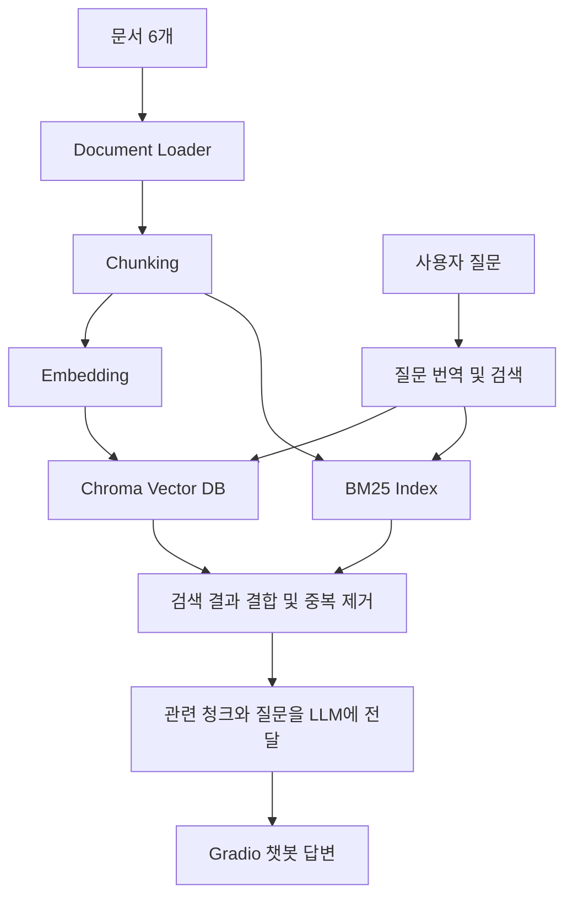

# 2026-11-25 | MCP 및 RAG 챗봇

[교육 기록 목록](../../README.md)

**학습 주제:** MCP, 외부 도구 연결, RAG(Retrieval-Augmented Generation), 문서 검색 개선  
**진행 상태:** MCP 학습 / 제공된 문서 6개를 사용한 RAG 챗봇 실습 참여 / 개인 최종 평가 점수 및 전체 코드 실행 결과 미확인

## 1. MCP 학습

11월 24일 기록에는 Tool & MCP 강의자료 전체의 개요가 포함되어 있다. 11월 25일에는 그중 MCP를 학습했다는 사용자 보고를 반영한다.

| 개념 | 역할 |
|---|---|
| Tool Calling | 모델이 외부 도구의 사용을 요청하고 결과를 답변에 활용하는 과정 |
| MCP | AI 애플리케이션과 외부 기능을 연결하는 표준 프로토콜 |
| Host | 사용자가 이용하는 AI 애플리케이션 |
| Client | Host 내부에서 MCP 서버와 연결 및 통신을 담당하는 구성 요소 |
| Server | 도구, 리소스 등 외부 기능을 제공하는 프로그램 |
| FastMCP | Python에서 MCP 서버와 클라이언트를 구현하는 데 사용하는 라이브러리 |

### 1.1 서버 및 클라이언트

강의자료 33–67쪽의 주요 구현 구조를 정리했다.

- `FastMCP()`로 서버 객체 생성
- `@mcp.tool`로 함수를 도구로 등록
- 함수 이름, 타입 힌트, 설명을 기반으로 도구 스키마 구성
- `mcp.run()`으로 서버 실행
- `Client`, `async with`, `await client.call_tool()`을 활용한 비동기 연결 및 호출
- `list_tools()`에서 가져온 정보를 Responses API의 function tool 형식으로 변환
- 도구 호출 결과와 `call_id`, `previous_response_id`를 연결하여 모델에 재전달

### 1.2 Remote MCP 및 Connector

강의자료 68–79쪽에는 원격 MCP 서버 URL을 통한 연결, Connector 식별자와 OAuth 인증을 통한 외부 서비스 연동, 로컬·원격 도구를 함께 활용하는 과제가 포함된다.

API 키 및 접근 토큰은 환경 변수로 관리한다. 외부 서비스의 개인정보 조회나 변경 기능은 별도 권한 및 승인 범위를 고려해야 한다.

MCP 개별 실습의 개인 실행 여부는 추가 확인이 필요하다. [이전 강의 개요](2026-11-24.md#4-mcp-3467쪽)

## 2. RAG 챗봇 실습 개요

**실습 자료:** RAG챗봇만들기_배포용.ipynb 및 문서 6개

제공된 사내 문서 예제들을 `data` 폴더에 넣고, 여러 문서 형식의 정보를 검색하여 질문에 답하는 챗봇을 실습했다. 과제의 목적은 검색 및 답변 성능을 조정하여 저지 사이트의 평가 점수를 높이는 것이다.

### 2.1 문서 데이터

| 자료 | 형식 | 내용 | 로더 |
|---|---|---|---|
| 신규 입사자 안내 | TXT | 입사 절차 및 기본 안내 | TextLoader |
| 근무 및 복무 안내서 | TXT | 근무, 휴가, 시설, 복무 규정 | TextLoader |
| 로봇 사용 설명서 | PDF | 영문 제품 사양 및 사용 안내 | PyPDFLoader |
| 경비 및 출장 규정 | DOCX | 경비 사용, 승인 및 정산 | Docx2txtLoader |
| 회의실 목록 | CSV | 회의실 식별자, 수용 인원, 시설 등 | CSVLoader |
| 기술 장애 보고서 | MD | 영문 장애 기록 및 사후 분석 | TextLoader |

한국어와 영어 문서가 혼합되어 있으며, 서술형 규정과 정확한 식별자·숫자를 담은 표 형식 데이터가 포함된다.

첨부 자료에서 PDF는 21쪽, CSV는 헤더를 제외한 157개 행임을 확인했다. 배포용 노트북의 저장 출력은 TXT 2개, DOCX 1개, Markdown 1개를 각각 하나의 Document로, PDF를 21개, CSV를 157개로 처리하여 총 182개 Document를 구성한 예시를 보여준다.

원본 교육용 문서 및 노트북 전체는 공개 저장소에 포함하지 않는다.

## 3. Long Context에서 RAG로 (Part 1–2)

Long Context 방식은 문서 전체를 모델에 전달한다. 짧은 문서는 단순하게 처리할 수 있으나 문서가 길어지거나 질문 횟수가 늘면 반복 입력 비용과 컨텍스트 길이 제한이 문제가 된다.

RAG는 질문과 관련된 문서 조각을 먼저 검색하고, 해당 조각을 답변 생성의 근거로 제공하는 방식이다. 모델 자체를 추가 학습시키는 방식과 다르다.

### 3.1 Chunking과 Overlap

- `split_fixed(text, size)`: 고정 길이로 문서 분할
- `split_overlap(text, size, overlap_size)`: 인접 청크에 일정 구간을 중복 포함
- 고정 분할은 문장 또는 규정의 조건이 경계에서 잘릴 수 있다.
- Overlap은 경계 문맥을 보존하지만 청크 수와 중복 데이터가 늘어날 수 있다.

배포용 노트북의 예시 출력은 근무 안내서의 500자 고정 분할에서 76개, 500자 분할과 100자 중복 적용에서 95개 청크를 보여준다. 이는 제공된 출력 예시이며 개인 측정 결과가 아니다.

### 3.2 Embedding 및 Vector DB

- 임베딩 모델: `text-embedding-3-small` (노트북에서 지정)
- `client.embeddings.create()`로 텍스트를 숫자 벡터로 변환
- `chromadb.Client()`로 Chroma 클라이언트 생성
- `collection.add()`로 청크 ID, 텍스트, 벡터 및 필요 시 출처 메타데이터 저장
- `collection.query()`로 질문 벡터와 가까운 청크를 검색

임베딩 기반 검색은 표현이 다르더라도 의미가 비슷한 문서를 찾는 데 유용하다. 정확한 코드나 번호 검색에는 한계가 있을 수 있다.

## 4. 여러 문서 형식 처리 및 인덱싱 (Part 3–4)

LangChain Community의 형식별 로더를 이용해 입력 자료를 공통 `Document(page_content, metadata)` 구조로 변환한다.

`RecursiveCharacterTextSplitter`로 가능한 자연스러운 텍스트 경계를 기준으로 분할하고, 출처 정보(`metadata["source"]`)를 유지한다.

| 설정 | 노트북의 기본값 | 의미 |
|---|---:|---|
| CHUNK_SIZE | 500 | 청크 최대 글자 수 |
| CHUNK_OVERLAP | 50 | 인접 청크 중복 길이 |
| TOP_K | 4 | 답변에 전달할 검색 결과 수 |
| CANDIDATES | 8 | Hybrid Search의 각 검색 후보 수 |

`rebuild()`의 설계는 기존 컬렉션을 재생성하고, 임베딩을 100개 단위로 요청하여 청크와 출처를 저장하는 방식이다. Hybrid Search가 활성화된 경우 BM25 인덱스도 새 청크를 기준으로 재구축한다.

배포용 노트북의 저장 출력에서는 559개 청크와 Chroma 저장 개수 559개가 표시된다. 제공된 코드에는 일부 빈 실습 셀이 있으므로 이 숫자를 개인 구현의 재현 결과로 간주하지 않는다.

## 5. 챗봇과 RAG 튜닝 (Part 5–6)

`retrieve()`에서 관련 Document를 가져오고 `answer_question()`에서 출처와 본문을 결합하여 답변 생성 함수에 전달한다. `gr.ChatInterface`로 질문과 답변 UI를 구성한다.

`DEBUG` 및 `show_retrieved()`를 사용하면 모델에 전달되는 청크를 확인할 수 있다.

| 문제 | 점검 방향 |
|---|---|
| 필요한 문장이 청크 경계에서 끊김 | CHUNK_SIZE 또는 CHUNK_OVERLAP 검토 |
| 관련 문서가 검색 결과에 없음 | 검색 방식, TOP_K, 청크 구성 확인 |
| 근거가 있는데 답변이 틀림 | SYSTEM_PROMPT 및 답변 구성 검토 |
| 문서에 없는 답변을 생성함 | 근거 제한 및 정보 없음 응답 규칙 강화 |
| 한국어 질문에서 영어 문서 검색 실패 | 질문 번역 및 다국어 검색 검토 |

노트북의 시스템 프롬프트는 문서에 근거한 답변, 정보 부재 시 명시적 응답, 한국어 출력, 원문 식별자 및 숫자 보존 등을 요구한다. 상충하는 문서나 예외 규정의 처리도 별도 확인할 필요가 있다.

## 6. 검색 성능 개선 (Part 7)

### 6.1 질문 번역

`translate_query()`는 원본 질문을 반대 언어의 검색어로 변환하도록 설계되어 있다. 노트북의 예제 모델은 `gpt-4.1-mini`다.

한국어 질문과 영문 문서 사이의 검색 격차를 줄이기 위해 원문 질문과 번역 질문을 함께 사용한다. 제품명, 식별자, 숫자를 보존하는 것이 중요하다. 번역 및 추가 임베딩 호출로 응답 시간과 비용이 증가할 수 있다.

### 6.2 BM25와 Kiwi 형태소 분석

BM25는 질문과 문서의 단어 일치 및 출현 정보를 활용하는 검색 방식이다.

- `kiwipiepy.Kiwi`로 한국어 문장을 형태소 단위로 분리
- 명사, 동사, 형용사, 부사, 영어, 숫자 등 필요한 품사만 선택
- `BM25Retriever.from_documents()`에 `preprocess_func=tokenize` 적용
- 문서와 질문에 동일한 전처리 적용

정확한 회의실 코드 및 장애 식별자를 찾을 때 의미 기반 검색을 보완한다. 반대로 질문과 문서의 언어가 다르면 단어 일치가 부족할 수 있다.

### 6.3 Hybrid Search

노트북의 `advanced_retrieve(question, k)` 구현 흐름:

1. 원래 질문과 번역된 질문 준비
2. 각각의 질문으로 Chroma 벡터 검색
3. 각각의 질문으로 BM25 키워드 검색
4. 네 검색 목록에서 순위별로 번갈아 결과 수집
5. 출처와 본문을 기준으로 중복 제거
6. 상위 k개 청크 반환

이 실습은 별도의 가중치 계산이나 reranker를 사용하는 대신 순위별 교차 병합을 적용한다.

### 6.4 제공 노트북의 검색 결과 예시

| 테스트 | 벡터 검색 | 개선 방식의 저장 출력 |
|---|---|---|
| 특정 회의실 식별자 검색 | 상위 4개에 해당 CSV 행이 나타나지 않음 | BM25 1위, Hybrid Search 3위에 정답 행 포함 |
| 영문 제품 사양을 한국어로 질문 | 관련 영문 매뉴얼은 검색됐으나 정답 사양의 노출 여부 불명확 | Hybrid Search의 출력 미리보기만으로 정답 청크 포함을 확정할 수 없음 |

회의실 사례는 원본 CSV와 예시 출력을 대조했다. 검색 방식의 차이를 보여주는 사례이지 전체 평가 정확도가 개선되었다는 증거는 아니다.

Part 5–7의 저장 출력에는 Gradio 로컬 실행 메시지가 포함되어 있다. 배포용 파일에는 `# code here` 및 미완성 함수가 남아 있으므로 저장 출력만으로 사용자의 최종 코드가 완성되어 재현 가능하다고 단정하지 않는다.

## 7. 학습 기술 및 적용 방향

| 기술 | 역할 |
|---|---|
| Python | 데이터 처리, 함수, 검색 로직 |
| OpenAI Embeddings API | 문서 및 질문 벡터화 |
| ChromaDB | 벡터 인덱스 및 유사도 검색 |
| LangChain Community | 문서 로더 및 BM25 검색기 |
| RecursiveCharacterTextSplitter | 청크 분할 |
| Kiwi | 한국어 형태소 분석 |
| Hybrid Search | 의미 기반 검색과 키워드 검색 결합 |
| Gradio | 챗봇 인터페이스 |
| MCP | 외부 도구 및 서비스 연결 |

온라인 콘텐츠·크리에이터 팀 프로젝트에도 RAG를 활용하여 브랜드 가이드, 콘텐츠 기획 자료, 제작 이력 등을 검색하는 기능을 검토할 수 있다. 이는 개인 학습에서 도출한 적용 아이디어이며 팀에서 확정한 기능은 아니다.

## 8. 실행 확인 및 후속 작업

- 사용자 확인: 제공된 문서 6개를 RAG 챗봇 노트북에 넣어 실습에 참여했다.
- 자료 확인: 문서 형식, 모델 지정, 청킹·검색 설정, 예제 출력, Hybrid Search 로직을 확인했다.
- 미확인: 개인 완성 코드, MCP 실습별 실행 성공, 저지 사이트 점수, 전체 질문의 정답률 및 응답 시간.

다음 실습에서는 정답이 포함된 청크의 검색 여부를 먼저 확인하고, 동일한 질문 세트로 벡터 검색과 Hybrid Search를 비교한다. 검색 성공률, 답변 정확도, 출처 일치 여부 및 응답 시간은 별도로 기록할 수 있다.

## 참고 자료

- 교육자료: [LLM] 03. Tool & MCP (MCP 단원 33–79쪽)
- 실습자료: RAG챗봇만들기_배포용.ipynb (Part 0–7)
- 사용자 실습 보고 및 첨부 문서 6개

공개 저장소에는 교육 원본, 내부 문서 전문, 인증 정보, 개인 정보 등을 게시하지 않았다.
