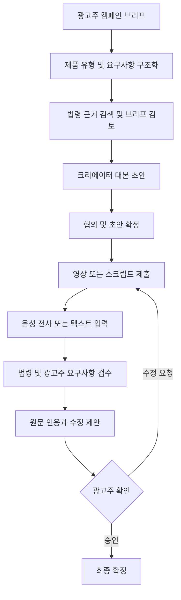

# Loop | AI 광고 콘텐츠 사전 검수 및 협업 플랫폼

[포트폴리오 홈](../../README.md) · [2026-11-27 작업 기록](../../learning/nvidia-ai-training/2026/11/2026-11-27.md)

**분야:** 온라인 콘텐츠·크리에이터 / AI 서비스 기획  
**유형:** NVIDIA AI 교육과정 미니 프로젝트  
**기간:** 2026-11-26 ~ 2026-11-30 (계획)  
**상태:** 기획 및 검수 데이터 설계, 프로토타입 통합·검증 진행 단계

## 1. 문제 정의

광고주와 크리에이터가 DM, 파일, 메신저로 광고 요청과 수정 내용을 주고받으면 요구사항 누락, 변경 이력 분산, 반복 수정 및 검수 부담이 발생할 수 있다. 화장품 광고의 경우 효능 표현, 제품 분류, 실증 자료 및 협찬 고지를 별도로 확인해야 한다.

Loop는 캠페인 브리프를 중심으로 초안 작성, 콘텐츠 사전 검수, 수정 요청, 최종 승인을 연결하는 서비스다. 검수 결과는 자동 법률 판단이나 공식 심의 결과가 아니라 담당자의 확인을 돕는 근거 기반 검토 의견이다.

## 2. 서비스 흐름

위 구성은 프로젝트 설계이며 전체 단계의 실제 통합 동작은 별도 확인이 필요하다.

## 3. 핵심 기능 및 설계

| 기능 | 설계 내용 |
|---|---|
| Campaign Brief | 브랜드, 제품 유형, USP, 타깃, 필수 문구·장면, 금지 표현, 매체, 일정 등을 구조화 |
| 초안 작성 | 브리프와 법령 조건을 참고하여 광고 스크립트 초안 및 수정 방향 제안 |
| 문장·음성 검수 | 텍스트 또는 영상에서 전사한 발화를 입력으로 사용 |
| 근거 검색 | 공통 광고 규정과 업종별 법령을 구분하고 적용 범위에 맞게 검색 |
| 결과 출력 | 원문, 위험 유형, 판단 사유, 관련 근거, 수정 제안 및 추가 확인 사항 |
| 승인 흐름 | 광고주 확인, 수정 요청, 재제출, 최종 승인 |

MVP는 일반 화장품 협찬 릴스의 대사 검수에 집중한다. 화면·자막·설명란을 확인하지 못하는 경우 해당 요소를 준수 또는 위반으로 확정하지 않는다. 실시간 채팅, 영상 편집, 다업종 자동 판정은 초기 범위 밖이다.

## 4. 법령 및 검수 데이터 설계

공식 자료 목록은 76개 검토 항목, 80개 공식 출처를 정리한 인벤토리로 구성되었다. 공유 자료의 원문 폴더에서 57개 파일을 확인했다. 이 수치는 자료 정리 규모이며 인덱싱 완료 수 또는 검수 성능이 아니다.

화장품 광고 검수용 입력표는 다음 7개 위험 유형으로 구성한다.

| 유형 | 검토 기준 |
|---|---|
| 질병 예방·치료 오인 | 질병 치료 효과를 제품에 귀속하는지 |
| 의약품 오인 | 처방약 대체 또는 동일 치료 효과 주장인지 |
| 기능성 오인 | 제품의 실제 분류 및 심사·보고 범위와 일치하는지 |
| 거짓·과장 | 표현과 확인된 자료가 불일치하거나 범위를 부풀리는지 |
| 경험담·기만 | 실제 사용 경험, 대가 관계와 고지 여부 |
| 부당 비교·비방 | 비교 대상, 기준, 시험 조건 및 입증 자료 |
| 실증 필요 | 효능 수치, 지속 기간, 안전성, 순위 등의 객관적 증빙 |

핵심 참고 범위는 화장품법 제13조·제14조, 화장품법 시행규칙 별표 5, 표시광고법, 추천·보증 관련 심사지침이다. 게시 시점의 시행본 및 사실관계를 확인하는 것을 전제로 한다. 판례는 직접 적용 가능한 규정과 사실관계가 일치할 때 보조 참고로 활용한다.

## 5. 검수 로직 설계

단순 금지어 일치율을 법령 위반의 확률로 취급하지 않는다. 유사도는 후보 근거를 검색하는 데 사용하고 실제 판정은 제품 분류, 문맥, 증빙, 예외 조건 및 매체를 대조하도록 설계한다.

- 법령 기준, 브랜드 요청 기준, 플랫폼 정책을 별도 검토 축으로 분리
- 금지 예시를 인용하거나 부정하는 문장과 실제 광고 주장을 구분
- 실제 자료와 충돌하는 표현과 자료가 아직 제공되지 않은 표현을 구분
- 확인할 수 없는 영상 요소 및 인식 불확실 구간은 추가 확인 대상으로 처리
- 실제 입력에서 확인된 인용문과 근거 식별자를 함께 남김
- 법령 근거가 부족하면 단정하지 않고 사람의 검토로 넘김

### 데이터 구조 (설계)

| 영역 | 주요 필드 |
|---|---|
| 법령 근거 | 근거 ID, 법령명, 조항, 원문 출처, 적용 조건, 예외, 시행일, 확인일 |
| 위험 예시 | 유형, 금지·허용 예시, 기대 상태, 근거 ID, 판단 전제 |
| 캠페인 | 제품 분류, 협찬 관계, 게시 매체, 필수 조건, 금지 표현 |
| 검수 결과 | 실제 문장, 검토 축, 상태, 사유, 출처, 수정 방향, 사람 확인 여부 |

법령 DB에는 재사용할 근거와 대표 예시를 저장하고, 프롬프트에는 근거 적용 절차와 문맥 판단 규칙을 두며, 평가 데이터는 별도로 관리하는 구조를 검토했다. 실제 DB 스키마 및 연동 여부는 미확인이다.

## 6. 기술 구성 및 검증 계획

| 구분 | 기술 또는 방법 | 확인 범위 |
|---|---|---|
| AI | LLM, RAG, LangChain | 기획안 기재 및 적용 설계 |
| 데이터 | 공식 법령, 위험 유형별 입력표 | 자료 확인 |
| 입력 | 스크립트, 영상 음성 전사 | 기능 계획 |
| 서비스 | 웹 캠페인 화면, 검수 및 승인 흐름 | 프로토타입 주소 공유, 직접 실행 미확인 |

팀 가이드의 초기 검증 목표는 10문장 × 3항목 중 24개 이상 일치하는 것이다. 동일 입력 반복 시 일관성, 처리 시간, 비용, 빈 입력과 무음 등 예외 상황도 확인할 계획이다. 목표와 실제 달성 수치는 구분하며 최종 성능은 아직 확인하지 못했다.

## 7. 기록 범위

이 문서는 교육과정 프로젝트 전체의 기획 및 기술 설계를 정리한 포트폴리오 문서다. 법령·데이터 조사 및 검수 기준 정리 작업과 프로젝트 전체 설계를 함께 다루며, 개별 기능의 단독 개발이나 전체 시스템의 구현 완료를 주장하지 않는다. 교육 자료, 팀 내부 원문, 인증 정보 및 접근 권한이 확인되지 않은 데모 주소는 공개하지 않는다.

[일자별 상세 작업 기록](../../learning/nvidia-ai-training/2026/11/2026-11-27.md)
